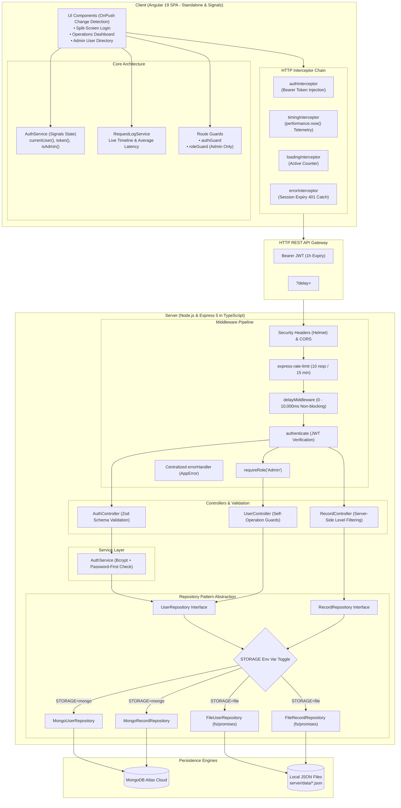

# AccessDesk — Enterprise Role-Based Access Portal

[](https://www.typescriptlang.org/)
[-dd0031.svg)](https://angular.dev/)
[](https://nodejs.org/)
[](https://expressjs.com/)
[](https://www.mongodb.com/)

**AccessDesk** is a modern Single Page Application (SPA) designed with a strict role-based access control (RBAC) model, dynamic security clearance tiers, real-time HTTP telemetry auditing, and latency simulation.

---

## 🏛️ System Architecture

The following Mermaid diagram illustrates the end-to-end data flow, authentication lifecycle, and layered repository design:



---

## 🔑 Key Features

### 1. Dual Persistence Engine (Repository Pattern)
Data access is isolated behind `UserRepository` and `RecordRepository` interfaces. Switch seamlessly between persistent MongoDB Atlas and local asynchronous JSON files by changing a single environment variable:
```env
# Switch instantly with zero code changes:
STORAGE=file    # Reads/writes server/data/users.json & records.json
STORAGE=mongo   # Connects to MongoDB Atlas via Mongoose
```

### 2. Strict Role-Based Access Control (RBAC) & Clearance Tiers
- **Roles**: `General User` vs `Admin`.
- **Hierarchical Access Levels**: `Public` < `Internal` < `Confidential` < `Restricted`.
- **Server-Side Filtering**: General Users have `Internal` clearance and **only** receive records up to `Internal`. Administrators receive all records up to `Restricted`.
- **Password-First Authentication**: Passwords are confirmed with `bcrypt` before role verification, mitigating account enumeration attacks and returning consistent 401s.

### 3. Latency Simulation & Telemetry Timeline
- Every data endpoint accepts `?delay=<ms>` (clamped to 0–10,000ms), handled by a non-blocking Express middleware using asynchronous `setTimeout` promises.
- **Frontend Latency Simulator**: Toggle between **Fast (0ms)**, **Slow (3s)**, and **Very Slow (8s)** on the dashboard.
- **Request Cancellation**: Queries are pipelined through RxJS `switchMap`, instantly cancelling stale in-flight HTTP requests when filters change.
- **Request Timeline Panel**: In-flight requests, completed status codes, and exact duration in milliseconds are rendered in real time.

### 4. Admin User Management with Self-Protection Guards
- Administrative table supporting user creation, profile editing, password resets, and account deletion.
- **Self-Operation Guards**: Administrators are strictly barred from deleting their own accounts or demoting themselves from the Admin role, preventing lockout scenarios.

---

## 👥 Test Credentials

After running `npm run seed`, the following test credentials are ready to use:

| User ID | Password | Role | Access Level | Permissions |
|---------|----------|------|--------------|-------------|
| `admin1` | `password123` | **Admin** | `Restricted` | Full admin privileges, all 4 record clearance levels |
| `admin2` | `password123` | **Admin** | `Restricted` | Secondary admin account |
| `user1` | `password123` | **General User** | `Internal` | Standard user, access limited to Public & Internal records |
| `user2` | `password123` | **General User** | `Internal` | Standard user |
| `user3` | `password123` | **General User** | `Internal` | Standard user |
| `user4` | `password123` | **General User** | `Internal` | Standard user |

---

## 🚀 Setup & Local Development

### 1. Backend Setup (`/server`)

```bash
cd server

# 1. Install dependencies
npm install

# 2. Configure environment (pre-configured with STORAGE=file)
cp .env.example .env

# 3. Seed users and dummy records
npm run seed

# 4. Start the development server
npm run dev

# 5. Run backend unit tests and integration tests
npm test            # Runs Vitest unit tests (10 passing tests)
npm run test:api     # Runs comprehensive E2E validation script
```

### 2. Frontend Setup (`/client`)

```bash
cd client

# 1. Install dependencies
npm install

# 2. Start the Angular development server
npm start
# Server opens at http://localhost:4200
```

---

## 📡 Complete REST API Specification

| Method | Endpoint | Authorization | Description |
|--------|----------|---------------|-------------|
| `POST` | `/api/auth/login` | Public (Rate-limited) | Validates credentials & role, returns 1h JWT |
| `GET` | `/api/me` | Bearer Token | Returns current authenticated user profile |
| `GET` | `/api/records` | Bearer Token | Returns records filtered by clearance tier |
| `GET` | `/api/users` | Admin Only | Lists all registered accounts |
| `POST` | `/api/users` | Admin Only | Provisions a new user account |
| `PUT` | `/api/users/:id` | Admin Only | Updates user details (self-demotion guarded) |
| `DELETE` | `/api/users/:id` | Admin Only | Deletes user account (self-deletion guarded) |
| `PATCH` | `/api/users/:id/reset-password` | Admin Only | Overwrites user password with a new hash |

---

## 🧪 Testing Suite

### Backend Unit Tests (`Vitest`)
Run `npm test` in the `/server` directory to execute unit test suites covering:
- **Delay Middleware**: Verifies boundary clamping, zero delays, and non-blocking asynchronous timers.
- **AuthService**: Verifies generic 401 responses, password-first verification, role mismatch 403s, and sanitized user returns.
- **AuthController**: Verifies Zod schema validation errors, role enum validation, and successful token generation.

### Frontend Unit Tests (`Karma/Jasmine`)
Run `npm test` in the `/client` directory to execute specs covering:
- **AuthService**: Signal state updates, computed `isAdmin()` checks, and `localStorage` synchronization.
- **authGuard**: Redirection of unauthenticated visitors with `returnUrl` preservation.

---

## 🚢 Production Deployment

### Option A: Deploying Frontend to Vercel (Recommended)
1. In the Vercel dashboard, click **Add New Project** and select the repository.
2. Set the **Root Directory** to `client`.
3. Framework Preset: **Angular** (uses `client/vercel.json` automatically).
4. Output Directory: `dist/client/browser`.
5. Production build automatically replaces `environment.ts` with `environment.prod.ts` pointing to `https://accessdesk-api.onrender.com/api`.
6. Click **Deploy**. Your Vercel frontend URL will be (e.g. `https://accessdesk.vercel.app`).

### Option B: Deploying Backend to Render
1. In the Render dashboard, click **New Web Service** from GitHub (or use the included `server/render.yaml` blueprint).
2. Root Directory: `server`.
3. Build Command: `npm install && npm run build`
4. Start Command: `npm start`
5. Environment Variables:
   - `NODE_ENV`: `production`
   - `STORAGE`: `mongo`
   - `MONGODB_URI`: `<Your MongoDB Atlas Connection String (Render Secret, sync: false)>`
   - `JWT_SECRET`: `<A strong random 32+ character secret>`
   - `CORS_ORIGIN`: `https://accessdesk.vercel.app` (or your actual Vercel client URL)

---

## 🎨 Design Philosophy & Creative Highlights

- **Custom Design Tokens**: Built entirely in SCSS using CSS variables—no default UI libraries or generic material themes.
- **Glassmorphism & Depth**: Multi-layered backdrop blurs (`backdrop-filter: blur(12px)`), refined border strokes, and contextual ambient box-shadows.
- **Fluid Light/Dark Themes**: Integrated theme engine respecting system `prefers-color-scheme` with persistence across sessions.
- **Telemetry-Driven UX**: Skeleton loading states, in-flight spinners, live average latency computation, and visual clearance level badges.
